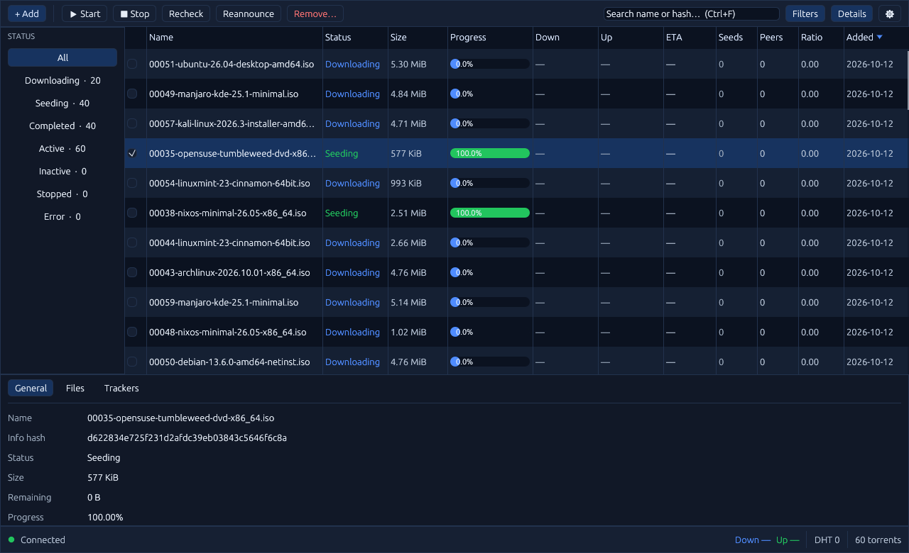
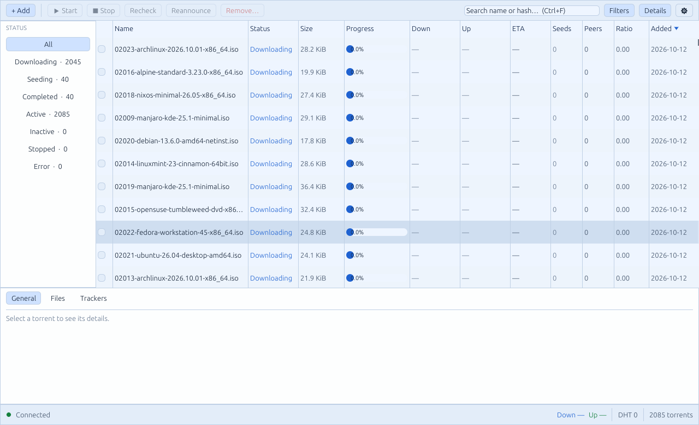

# TorrentNG Desktop

TorrentNG Desktop is a native app for Linux, macOS, and Windows. It is written
in Rust with [egui](https://github.com/emilk/egui) and does not embed a browser
or the React WebUI. It looks like the WebUI (same palette, layout, and status
vocabulary) and uses very little memory and CPU.



The light theme uses the same palette as the WebUI's light mode:



## Which TorrentNG part do I need?

| Name | Binary / source | What it is | Pick it when |
|---|---|---|---|
| **TorrentNG Desktop** | `torrentng-desktop` · `crates/torrentng-desktop` | Native app. Bundles the engine for local use and can connect to a server. | You want a torrent app on this computer. |
| **TorrentNG Server** | `torrentngd` · `crates/torrentngd` + `webui/` | Headless engine with the browser WebUI and REST/SSE/qBittorrent-compatible APIs. Also called "the Engine" or "the native client" in older docs. | You run torrents on a NAS, home server, or seedbox. |
| **TorrentNG Bridge** | `torrentng` · `sidecar/` | Puts the WebUI and APIs in front of qBittorrent, rTorrent, Transmission, or Deluge. Also called "the compatible-client service" or "sidecar". | You keep an existing client. |

Directory and crate names are unchanged for compatibility; only the
user-facing names are unified. The Desktop app and the Server are the same
engine and the same API, so a Desktop app can manage a remote Server.

```text
Desktop app ──(loopback, bearer token)──► torrentngd  ◄── browser WebUI
     └──────(LAN/VPN, bearer token)─────► torrentngd (remote server)
```

## Install

Download from the [releases page](https://github.com/snapetech/TorrentNG/releases)
and verify against `SHA256SUMS-<tag>.txt`.

| OS | File | Install |
|---|---|---|
| Debian / Ubuntu | `torrentng-desktop_<version>_{amd64,arm64}.deb` | `sudo apt install ./torrentng-desktop_*.deb` |
| Any Linux | `torrentng-desktop-<tag>-linux-{x86_64,aarch64}.tar.gz` | Extract and run `torrentng-desktop`. |
| macOS (Apple silicon) | `torrentng-desktop-<tag>-macos-aarch64.dmg` | Drag **TorrentNG** to Applications. |
| Windows | `torrentng-desktop-<tag>-windows-x86_64.zip` | Extract and run `TorrentNG.exe`. |

Every bundle contains the matching `torrentngd`, so Local mode works with no
extra setup. Linux needs a working OpenGL/EGL driver (`libgl1`/`libegl1`) and
`libxkbcommon`; Wayland and X11 are both supported. The macOS build is only
ad-hoc signed (not notarised): on first launch use right-click → Open.

## First run

Choose where torrents run:

- **This computer** starts the bundled engine on `127.0.0.1` (random port,
  random per-launch token) and stops it when you close the window. Set the
  download folder and peer port here.
- **Another machine** takes the Server URL and an API token (the value of
  `auth.api_tokens` / `TORRENTNGD_API_TOKEN` on the server). Put the server
  behind HTTPS when it is not on a trusted network.

You can change this later under ⚙ Settings. Torrents are added with **Add**
(magnet links, `.torrent` file picker) or by dropping a `.torrent` file on the
window. `Ctrl/Cmd+N` adds, `Ctrl/Cmd+F` searches, `Ctrl/Cmd+A` selects the
loaded rows, and `Delete` removes. Everything in the toolbar is also on the
row context menu; nothing requires right-click.

Settings are stored (mode 0600) at:

| OS | Path |
|---|---|
| Linux | `~/.config/torrentng-desktop/config.toml` |
| macOS | `~/Library/Application Support/TorrentNG Desktop/config.toml` |
| Windows | `%APPDATA%\TorrentNG Desktop\config.toml` |

The local engine's session database, `engine-config.toml` (holds the launch
token, mode 0600) and `engine.log` live in the app data directory next to it
(`~/.local/share/torrentng-desktop` on Linux). `TORRENTNG_DESKTOP_CONFIG_DIR`
and `TORRENTNG_DESKTOP_DATA_DIR` override both.

The remote API token is stored in `config.toml` in plain text, protected only
by file permissions. Use a dedicated token with the access you intend.

## How it stays light

- **Windowed table.** Only a page of rows around the viewport is held. Sorting,
  filtering, and pagination happen on the server (`GET /api/v1/torrents`), so a
  100k-torrent library costs the same memory as a 100-torrent one.
- **Deltas, not polling.** After each page the app opens
  `GET /api/v1/events?last_known_revision=<page revision>`, so the server sends
  only changes. In-window changes patch rows in place; additions and removals
  trigger one debounced page refetch. A stale cursor makes the app reload its
  window rather than ingest a full snapshot.
- **Rates for visible rows only.** `GET /api/v1/torrents/live` is polled every
  2 s for the (≤128) visible rows.
- **Idle means idle.** egui repaints only on input or data; while the window is
  minimized all polling stops, incoming deltas are ignored (the stream stays
  connected), and the app refreshes once when restored. If the delta stream is
  unavailable the app falls back to a slow page refresh.
- **No GPU stack.** The `glow` (OpenGL) backend is used instead of `wgpu`.
- **Quiet when nothing changes.** The controller remembers what it last gave
  the UI and drops identical transfer totals, facet counts, live rates, pages,
  and SSE deltas that do not change a visible row. Every event wakes the UI, so
  an idle library causes no redraws.
- **Engine isolation.** The engine is a separate child process, so a UI crash
  cannot corrupt torrent state and the guarantees in
  [CRASH_SAFETY.md](CRASH_SAFETY.md) are unchanged. Closing the window sends
  `SIGTERM` (Windows: terminates) and waits up to 15 s for a clean stop. If the
  app itself is killed, the next launch finds the engine it left behind (a
  `engine.pid` record with that launch's token) and stops it, but only if the
  process still answers with that token, so an unrelated `torrentngd` is never
  touched.

### Measured footprint

Release build, connected to an engine holding 2,085 torrents, on a virtual
display with Mesa's *software* renderer (no GPU, so GL cost is at its worst):

| | |
|---|---|
| Idle CPU (20 s, nothing changing) | 2-4 ticks, about 0.1-0.2 % of one core |
| Resident memory after start | about 116 MB |
| After scrolling the whole list | about 130 MB (does not grow with library size) |

Most of that memory is the GL stack and font atlas, not torrent data. These are
single-machine measurements, not release gates; results on a real GPU were not
measured.

The engine has its own limits: a Local engine's metadata cap scales with the
memory setting (`memory_cap_mb / 8`, at least 32 MB). Libraries of thousands of
small torrents need a larger cap than the 256 MB default.

## Current limits

Desktop v1 covers the day-to-day loop: add, start/stop, recheck, reannounce,
remove (optionally with data), search, status filters, sorting, and a detail
dock with General / Files / Trackers. Not in v1:

- Connecting to a **Bridge** (`torrentng`): the app speaks the native
  `torrentngd` API only. Use the WebUI for Bridge deployments.
- Categories, tags, RSS, workflows, ratio groups, storage tools, and crash-safety
  settings: use the WebUI on a Server, or tune the engine through its config.
- System tray, start-at-login, and `.torrent`/`magnet:` file association.
- Signed/notarised macOS and Windows installers.

## Build from source

```sh
cargo build --release --manifest-path crates/torrentng-desktop/Cargo.toml
cargo build --release -p torrentngd        # put it next to the app for Local mode
```

The crate is a standalone Cargo workspace (like `sidecar/`) so the GUI
dependency tree does not affect the engine's lockfile, MSRV, or CI. Tests:

```sh
cargo test --manifest-path crates/torrentng-desktop/Cargo.toml
# plus the end-to-end test that launches a real engine:
TORRENTNGD_BIN=$PWD/target/debug/torrentngd \
  cargo test --manifest-path crates/torrentng-desktop/Cargo.toml --test engine_roundtrip
```

Theme tokens live in `crates/torrentng-desktop/src/theme.rs` and are the
default `tng` palette from `webui/src/themes.ts`; update both together.

## Troubleshooting

- **"torrentngd was not found"**: the engine must sit next to the app (or in
  `../lib/torrentng-desktop/`, or on `PATH`). Set its path in Settings.
- **Engine exits at start**: the error dialog shows the tail of `engine.log`.
  A busy peer port is the usual cause; change it in Settings.
- **"Authentication failed"** (remote): the server rejected the token; check
  `auth.api_tokens` on the server.
- **Blank window on Linux**: install Mesa/GL drivers. To force X11 on a Wayland
  session, start it with `WAYLAND_DISPLAY=` unset.
